# LibraCalc

**English** · [Русский](README.md)

**AI food diary for families living with type 1 diabetes. Snap a plate, get carbs.**


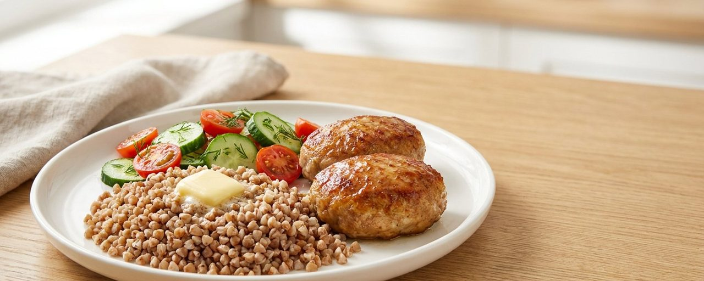

**[Try LibraCalc →](https://libracalc.ru/?src=github)** · PWA and Telegram Mini App · guest login, no sign-up · interface in Russian

> Public showcase. The main repository is private: it holds the production infrastructure,
> provider configuration and users' medical data. Here: the problem, the architecture,
> key decisions and the part of the code that can be shown, with tests.

---

## The problem

With type 1 diabetes, carbohydrates have to be counted before every meal, 4–6 times a day:
the insulin dose depends on it. At school, in a café or at a friend's place there are no
scales, and a 20–30 g carb error means hypo- or hyperglycaemia a couple of hours later.

Photo calorie counters don't solve this. The model is confidently wrong, especially on
Russian food (borscht, pelmeni, set lunches in a canteen). The user gets a single number
with no range and no idea where it came from.

## What LibraCalc does

```
open the app → "Food photo" → snapshot → carbs and XE (range, components, grams)
             → adjust grams if needed → "Save" to the diary
```

- **Recognition**: a plate (one or several photos), a package (nutrition table from the
  label, barcode), a canteen or café menu with portion weights. The estimate is shown
  **as a range**, and the user adjusts the grams.
- **Diary**: food, insulin, and glucose from a FreeStyle Libre sensor via LibreLinkUp or from
  any app with a Nightscout upload (xDrip+, Juggluco).
- **Family diary**: parents keep a child's diary together, by invitation.
- **Report for the doctor**: CSV and PDF for any period.
- **Telegram bot**: send a photo to the chat, get carbs and XE back, saved to the same diary.

> **XE (bread unit)** is the carb unit used with insulin therapy in Russia and Eastern Europe:
> 1 XE ≈ 10–12 g of carbohydrates.

## Screenshots

The app interface is in Russian.

### Food photo

A photo of the plate: AI finds the dishes and estimates their weight, code computes carbs and XE from nutrition tables.

<table>
  <tr>
    <td align="center" width="33%">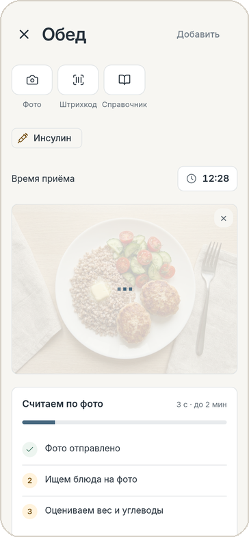</td>
    <td align="center" width="33%">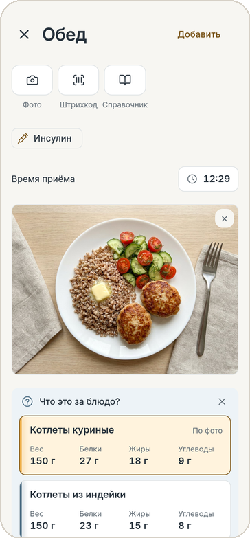</td>
    <td align="center" width="33%">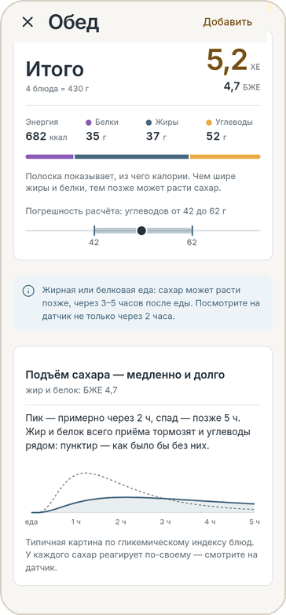</td>
  </tr>
  <tr>
    <td align="center"><b>Snapshot</b><br>calculation steps visible right away</td>
    <td align="center"><b>Which dish is it?</b><br>similar options with macros, one tap to choose</td>
    <td align="center"><b>Total</b><br>XE, error margin and expected glucose curve</td>
  </tr>
</table>

### Barcode

The code is read from the live camera feed. The product comes from a shared database or a store catalogue, with its composition and a photo of the pack.

<table>
  <tr>
    <td align="center" width="33%">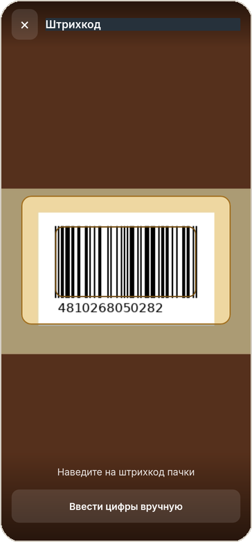</td>
    <td align="center" width="33%">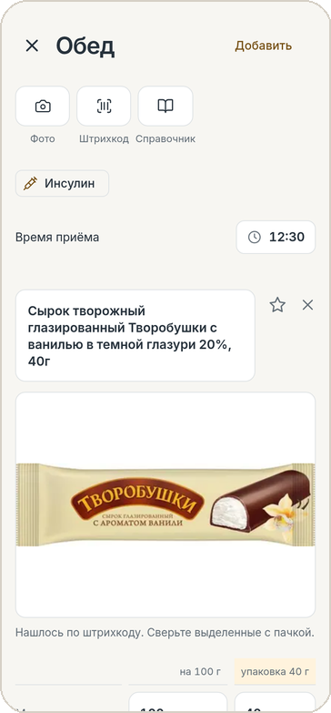</td>
    <td align="center" width="33%">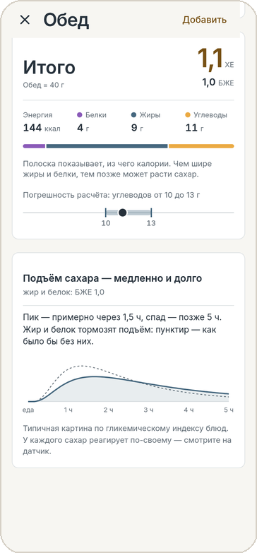</td>
  </tr>
  <tr>
    <td align="center"><b>Point the camera</b><br>no shutter button</td>
    <td align="center"><b>Found by barcode</b><br>composition from the pack, checked against the photo</td>
    <td align="center"><b>How much was eaten</b><br>40 g = 1.1 XE</td>
  </tr>
</table>

### Own dish

A home recipe: ingredients are entered raw, as they went into the pot, and the cooked yield is calculated from coefficients or from the weight of the pot.

<table>
  <tr>
    <td align="center" width="33%">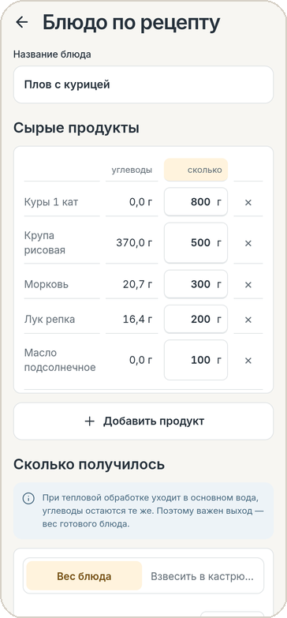</td>
    <td align="center" width="33%">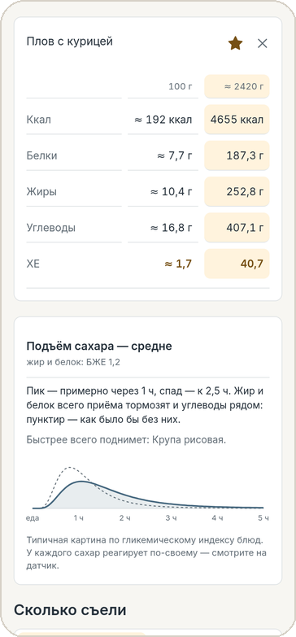</td>
    <td align="center" width="33%">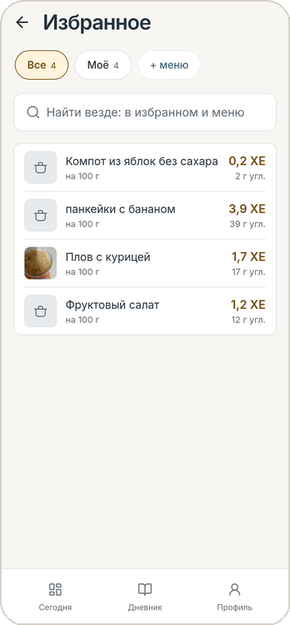</td>
  </tr>
  <tr>
    <td align="center"><b>Recipe</b><br>raw ingredients and cooked yield</td>
    <td align="center"><b>Dish card</b><br>per 100 g and per dish, glucose rise speed</td>
    <td align="center"><b>Favourites</b><br>your own dishes in one tap</td>
  </tr>
</table>

## Key decisions

**The LLM does not count carbs.** The model only recognises components and their mass.
Carbs and XE are computed by code from nutrition databases (Skurikhin–Tutelyan, USDA,
CoFID) in `Decimal`. A mass error by the model is visible and the user can fix it; an error
in "carbs from the model's head" is not.

**The most accurate source goes first.** A pack: barcode and label. Your own dish: its
saved recipe. Lunch in a canteen: that place's menu. A photo estimate of the plate is used
only when none of these is available.

**The app does not calculate insulin doses.** It did in the first version and was removed on
purpose: in Russia, software that calculates a dose is a medical device that requires
registration with Roszdravnadzor, the national health regulator.

**The model is chosen by measurement, not by leaderboard.** Before development, a "golden
set" was collected: Russian food with weighed components across 10 categories. The phase 0
gate was a median carb error below 15 g; otherwise the approach changes, not the product.
Models were compared on this set by carb accuracy, mass accuracy, p95 latency and price per
1,000 photos.

**Fault tolerance beats price.** The user is standing over the plate, so "service
unavailable" is not acceptable. Hence the two fallback chains below.

## Architecture

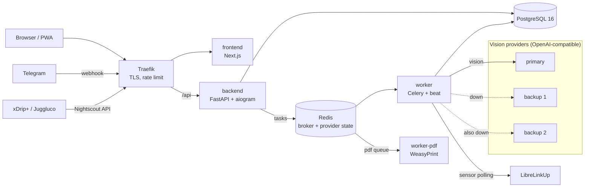

### Two fallback chains

Code: [`src/libra/vision/route.py`](src/libra/vision/route.py), [`src/libra/vision/client.py`](src/libra/vision/client.py),
tests: [`tests/test_fallback.py`](tests/test_fallback.py).

1. **Model chain per task.** Each task (plate, menu, label, dish macros) has its own
   "primary + backup" pair. If the first model doesn't answer, returns invalid JSON or runs
   over its time budget, the request goes to the second. The budgets are set so that both
   fit within the Celery task limit.
2. **Provider chain.** The request goes to the first live provider that has the model.
   - A provider is "down": no connection, 502/503/504 from the gateway, 401, or 402 after retries.
   - A model is "missing": 404/422, or a 400 complaining about the name. The request goes
     straight to the next provider, and that provider + model pair is skipped for 15 minutes.
   - The state is shared across all processes (keys in Redis). A provider that is down is
     checked once a minute with a real mini-request and an account balance check, and it
     comes back only after three minutes of stable probes. Otherwise the admin gets flooded
     with "down / up" messages.
   - Every switch is logged and sent to the admins in Telegram.

Without Redis the module runs on process memory (tests, local runs).

### Production numbers (5–15 Oct 2026)

| Metric | Value |
|---|---|
| Model calls per calculation | 3.1 |
| LLM cost per calculation | ≈ RUB 1.9 (≈ $0.02) |
| Successful calls | 95.2% (the rest went to a backup, invisibly to the user) |

Every model call is logged: task, provider, outcome, tokens, cost, time.

## Also in this repo

- [`src/libra/ean.py`](src/libra/ean.py): barcodes without a database. Check digit, EAN-8/13,
  UPC-A, GTIN-14, in-store codes with prefix 2 (a weighed item is recognised by matching the
  mass in the code with the sticker). Tests: [`tests/test_ean.py`](tests/test_ean.py).
- [`src/libra/sweets.py`](src/libra/sweets.py): packaged sweets. Code computes carbs per piece
  from the numbers on the label; glucose rise speed follows the typical pattern by fat content.

## Stack

| Layer | Technologies |
|---|---|
| Backend | Python 3.13, FastAPI, Pydantic 2, SQLAlchemy 2 + Alembic, psycopg 3 |
| Queue | Celery + beat on Redis 7 |
| Bot | aiogram 3, webhook inside FastAPI |
| AI | Vision LLMs with structured output (JSON Schema, strict), model and provider chains, versioned prompts in files, benchmark on our own set |
| Food data | Skurikhin–Tutelyan tables, USDA SR Legacy, CoFID; Nutrition5k for benchmarking |
| Glucose | LibreLinkUp, Nightscout API v1 ingestion |
| PDF | WeasyPrint (external URLs blocked) |
| Frontend | Next.js, React, TypeScript, Tailwind CSS, PWA, Telegram Mini App |
| Infrastructure | Docker Compose, Traefik v3, GitHub Actions (CI + gitleaks), non-root containers, versions pinned after CVE checks (OSV, trivy) |
| Data security | Sensor credentials encrypted (Fernet), food photos kept for 14 days, runtime DB role without DDL |

## Author

Aleksei Russkikh: [@Rubitco1](https://t.me/Rubitco1) · [libracalc.ru](https://libracalc.ru/?src=github). Product, architecture, backend, frontend,
infrastructure. Built with Claude Code.
