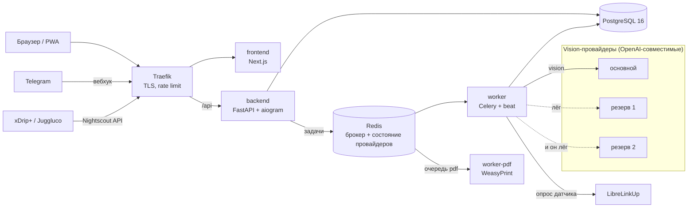

# LibraCalc — ИИ-дневник для семей с диабетом 1 типа


**Сфотографируй тарелку — получи углеводы и ХЕ.**

**[Открыть LibraCalc →](https://libracalc.ru/?src=github)** · PWA и Telegram Mini App, войти можно гостем, без регистрации

Публичная витрина проекта. Основной репозиторий закрыт: в нём боевая инфраструктура,
конфигурация провайдеров и работа с медицинскими данными пользователей. Здесь — задача,
архитектура, ключевые решения и часть кода с тестами, которую можно показать.

---

## Задача

При диабете 1 типа перед каждой едой, 4–6 раз в день, нужно посчитать углеводы и хлебные
единицы (ХЕ): от этого зависит доза инсулина. В школе, кафе или в гостях весов нет, а
ошибка на 20–30 г углеводов — это гипо- или гипергликемия через пару часов.

Фото-счётчики калорий для этого не годятся: модель уверенно ошибается, на русской еде
(борщ, пельмени, комплексный обед в столовой) — особенно. Человек получает число без
диапазона и без объяснения, откуда оно.

## Что делает LibraCalc

```
открыл приложение → «Фото еды» → снимок → углеводы и ХЕ (диапазон, состав, граммы)
                  → при необходимости правка граммов → «Сохранить» в дневник
```

- **Распознавание**: тарелка (одно или несколько фото), упаковка (таблица БЖУ с этикетки,
  штрихкод), меню столовой или кафе с выходом блюд. Оценка показывается **диапазоном**,
  человек правит граммы.
- **Дневник**: еда, инсулин, глюкоза с датчика FreeStyle Libre через LibreLinkUp или из любой
  программы с Nightscout-выгрузкой (xDrip+, Juggluco).
- **Семейный дневник**: родители ведут дневник ребёнка вместе, по приглашению.
- **Отчёт врачу**: CSV и PDF за период.
- **Telegram-бот**: фото в чат — ответ с углеводами и ХЕ, запись в тот же дневник.


## Как это выглядит

### Фото еды

Снимок тарелки — ИИ находит блюда и оценивает вес, углеводы и ХЕ считает код по справочнику.

<table>
  <tr>
    <td align="center" width="33%"></td>
    <td align="center" width="33%"></td>
    <td align="center" width="33%"></td>
  </tr>
  <tr>
    <td align="center"><b>Снимок</b><br>шаги расчёта видны сразу</td>
    <td align="center"><b>Что это за блюдо?</b><br>похожие варианты с БЖУ, выбор в одно касание</td>
    <td align="center"><b>Итог</b><br>ХЕ, погрешность и кривая подъёма сахара</td>
  </tr>
</table>

### Штрихкод

Код читается с живого видео камеры. Товар из общей базы или каталога магазина — сразу с составом и фото пачки.

<table>
  <tr>
    <td align="center" width="33%"></td>
    <td align="center" width="33%"></td>
    <td align="center" width="33%"></td>
  </tr>
  <tr>
    <td align="center"><b>Наведите камеру</b><br>без кнопки «снять»</td>
    <td align="center"><b>Нашлось по штрихкоду</b><br>состав с упаковки, сверка с пачкой</td>
    <td align="center"><b>Сколько съели</b><br>40 г — 1,1 ХЕ</td>
  </tr>
</table>

### Своё блюдо

Домашний рецепт: продукты вводятся сырыми, как клали в кастрюлю, выход блюда считается по коэффициентам или по весу кастрюли.

<table>
  <tr>
    <td align="center" width="33%"></td>
    <td align="center" width="33%"></td>
    <td align="center" width="33%"></td>
  </tr>
  <tr>
    <td align="center"><b>Рецепт</b><br>сырые продукты и выход блюда</td>
    <td align="center"><b>Карточка</b><br>на 100 г и на всё блюдо, скорость подъёма сахара</td>
    <td align="center"><b>Избранное</b><br>свои блюда — в одно касание</td>
  </tr>
</table>

## Ключевые решения

**LLM не считает углеводы.** Модель распознаёт только состав и массу компонентов.
Углеводы и ХЕ считает код по справочникам питания (Скурихин–Тутельян, USDA, CoFID) в
`Decimal`. Ошибка модели в массе видна и правится человеком; ошибка в «углеводах из
головы модели» — нет.

**Самый точный источник — первым.** Пачка — штрихкод и этикетка, своё блюдо — его
сохранённый состав, обед в столовой — меню места. Оценка тарелки по фото — когда ничего
из этого нет.

**Дозу инсулина приложение не считает.** Было в первой версии, убрано осознанно: программа,
которая считает дозу, в РФ — медицинское изделие с регистрацией в Росздравнадзоре.

**Модель выбирается замером, а не по рейтингу.** До разработки собран «золотой набор» —
русская еда со взвешенными компонентами по 10 категориям. Гейт фазы 0: медиана ошибки по
углеводам < 15 г, иначе меняется подход, а не продукт. Модели сравнивались прогонами на
этом наборе по точности углеводов, массы, задержке p95 и цене за 1000 фото.

**Отказоустойчивость важнее цены.** Человек стоит над тарелкой — «сервис недоступен» здесь
недопустим. Отсюда две цепочки фолбэка (ниже).

## Архитектура



### Две цепочки фолбэка

Код: [`src/libra/vision/route.py`](src/libra/vision/route.py), [`src/libra/vision/client.py`](src/libra/vision/client.py),
тесты: [`tests/test_fallback.py`](tests/test_fallback.py).

1. **Цепочка моделей по задаче.** У каждой задачи (тарелка, меню, этикетка, БЖУ блюда) своя
   пара «основная + запасная». Первая не ответила, вернула невалидный JSON или не уложилась
   в бюджет времени — запрос уходит второй. Бюджеты подобраны так, чтобы обе успели до
   лимита задачи Celery.
2. **Цепочка провайдеров.** Запрос идёт к первому живому провайдеру, у которого есть модель.
   - Провайдер «лежит»: нет соединения, 502/503/504 от шлюза, 401, 402 после повторов.
   - Модели «нет»: 404/422 или 400 с жалобой на имя — запрос сразу к следующему, пара
     провайдер+модель пропускается 15 минут.
   - Состояние общее для всех процессов (ключи в Redis), лежащий провайдер проверяется раз в
     минуту настоящим мини-запросом и балансом счёта, а возвращается только после трёх минут
     стабильных проб — иначе админа заваливает «упал / поднялся».
   - Каждый переход — в лог и сообщением администраторам в Telegram.

Без Redis модуль работает на памяти процесса (тесты, локальный запуск).

### Цифры с прода (05–15.10.2026)

| Показатель | Значение |
|---|---|
| Вызовов модели на один расчёт | 3,1 |
| Стоимость LLM на один расчёт | ≈ 1,9 ₽ |
| Успешных вызовов | 95,2 % (остальные ушли в резерв, незаметно для человека) |

Каждый вызов модели пишется в журнал: задача, провайдер, исход, токены, стоимость, время.

## Что ещё в коде здесь

- [`src/libra/ean.py`](src/libra/ean.py) — штрихкоды без базы: контрольная цифра, EAN-8/13,
  UPC-A, GTIN-14, внутренние коды сетей с префиксом 2 (весовой товар узнаётся сверкой массы
  из кода с наклейкой). Тесты — [`tests/test_ean.py`](tests/test_ean.py).
- [`src/libra/sweets.py`](src/libra/sweets.py) — сладости в упаковке: углеводы на штуку
  считает код по числам с этикетки, скорость подъёма сахара — типичная картина по жиру.

## Стек

| Слой | Технологии |
|---|---|
| Backend | Python 3.13, FastAPI, Pydantic 2, SQLAlchemy 2 + Alembic, psycopg 3 |
| Очередь | Celery + beat на Redis 7 |
| Бот | aiogram 3, вебхук внутри FastAPI |
| ИИ | Vision-LLM со структурированным выводом (JSON Schema, strict), цепочки моделей и провайдеров, промпты в файлах с версиями, бенчмарк на своём наборе |
| Данные о еде | Справочники Скурихина–Тутельяна, USDA SR Legacy, CoFID; Nutrition5k для бенчмарка |
| Глюкоза | LibreLinkUp, приём Nightscout API v1 |
| PDF | WeasyPrint (внешние URL запрещены) |
| Frontend | Next.js, React, TypeScript, Tailwind CSS, PWA, Telegram Mini App |
| Инфраструктура | Docker Compose, Traefik v3, GitHub Actions (CI + gitleaks), non-root контейнеры, версии фиксируются после проверки CVE (OSV, trivy) |
| Безопасность данных | Шифрование учётных данных датчика (Fernet), фото еды хранятся 14 дней, рантайм-роль БД без DDL |


## Автор

Алексей Русских — [@Rubitco1](https://t.me/Rubitco1) · [libracalc.ru](https://libracalc.ru/?src=github). Продукт, архитектура, бэкенд, фронтенд,
инфраструктура. Разработка с Claude Code.
